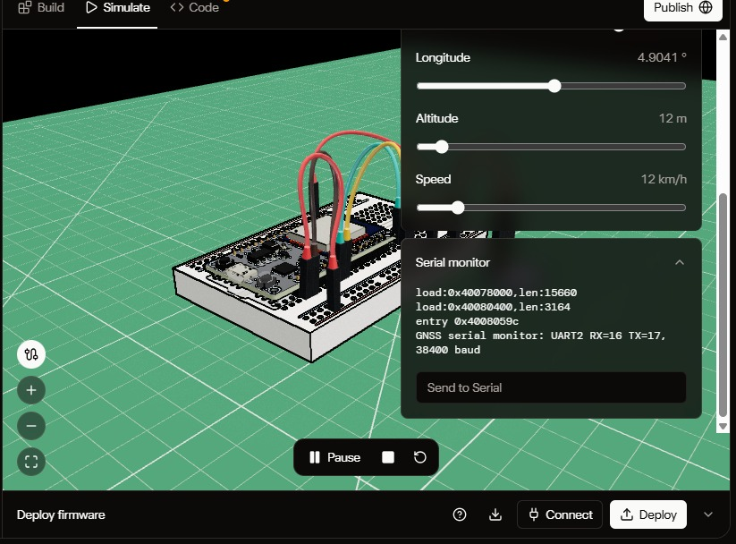

# Images du materiel GNSS

## Architecture de communication UART2 entre le module GNSS UM982 et l'ESP32

## Diagnostic des erreurs mémoire de l'ESP32 sur l'UART2 (FreeRTOS)

## Schéma de principe du câblage (batterie, régulateur, ESP32, GNSS)

> Illustration de principe, à ne pas suivre fil à fil. Au montage : batterie 3,7 V vers un
> convertisseur élévateur 5 V puis VIN de l'ESP32 ; broche 3,3 V de l'ESP32 vers VCC du GNSS ;
> masse commune ; GPIO16 (RX2) vers TX du GNSS et GPIO17 (TX2) vers RX du GNSS.

## Simulation de la réception des données GNSS sur ESP32 (UART2)

